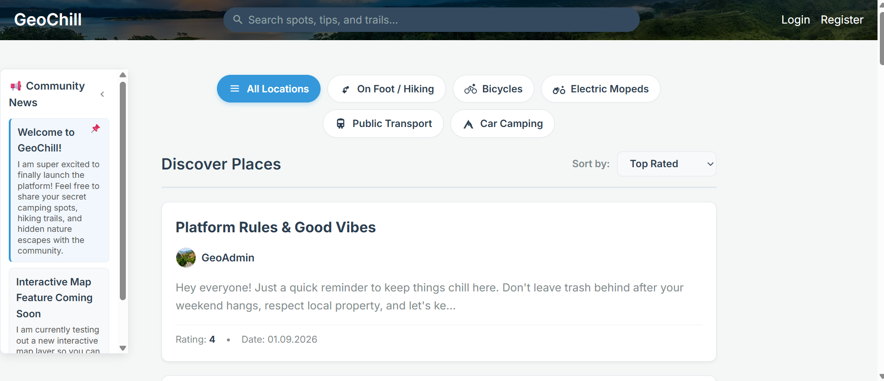
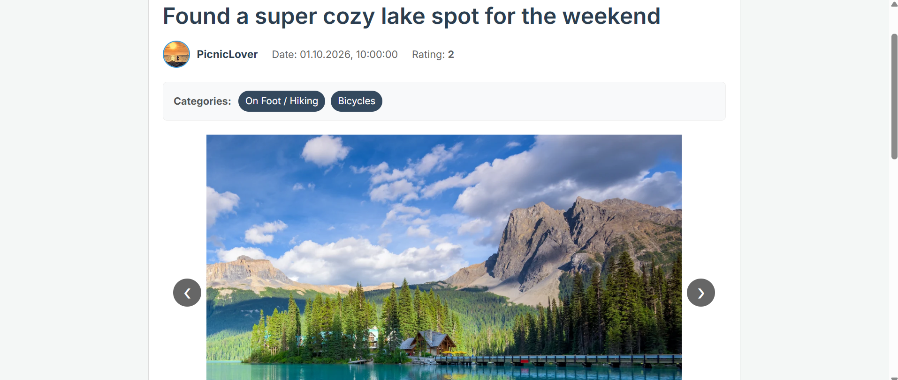
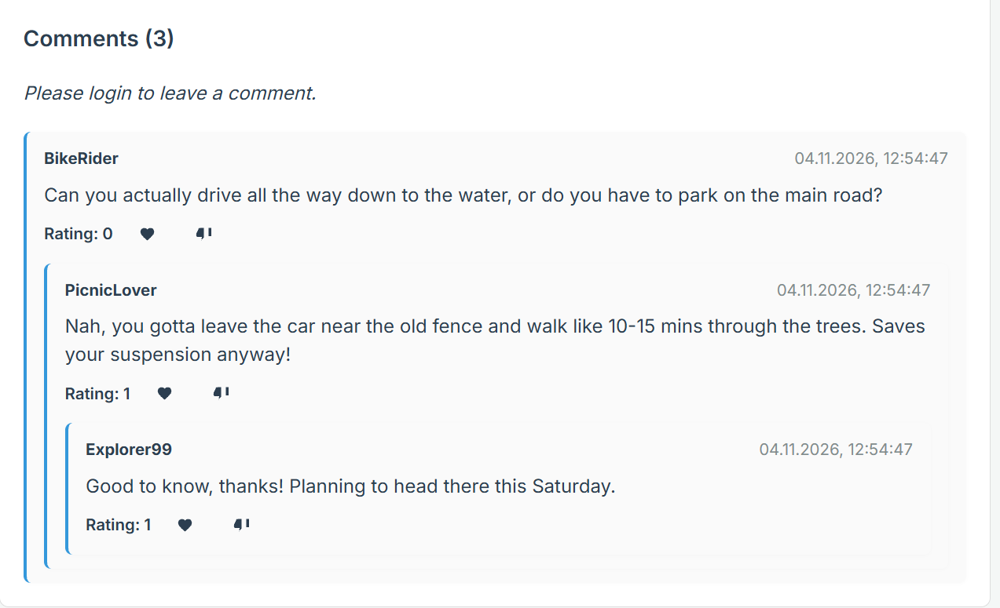
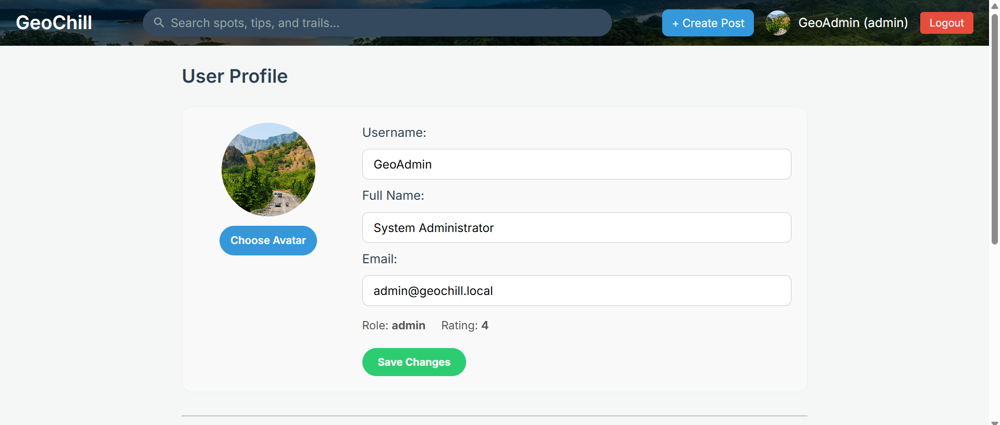
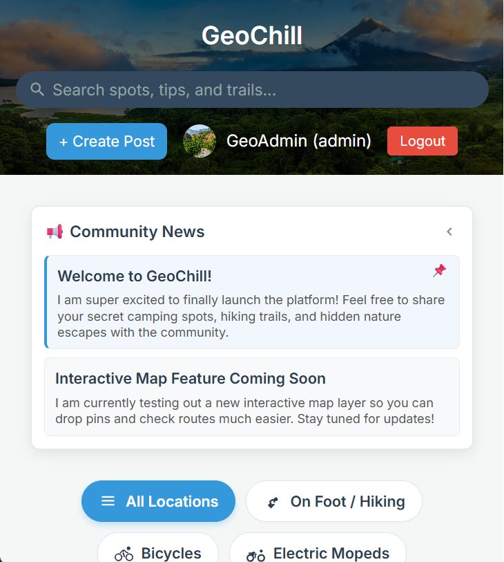
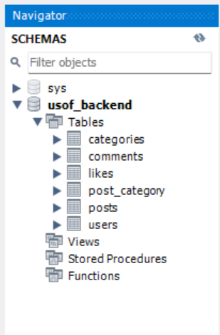
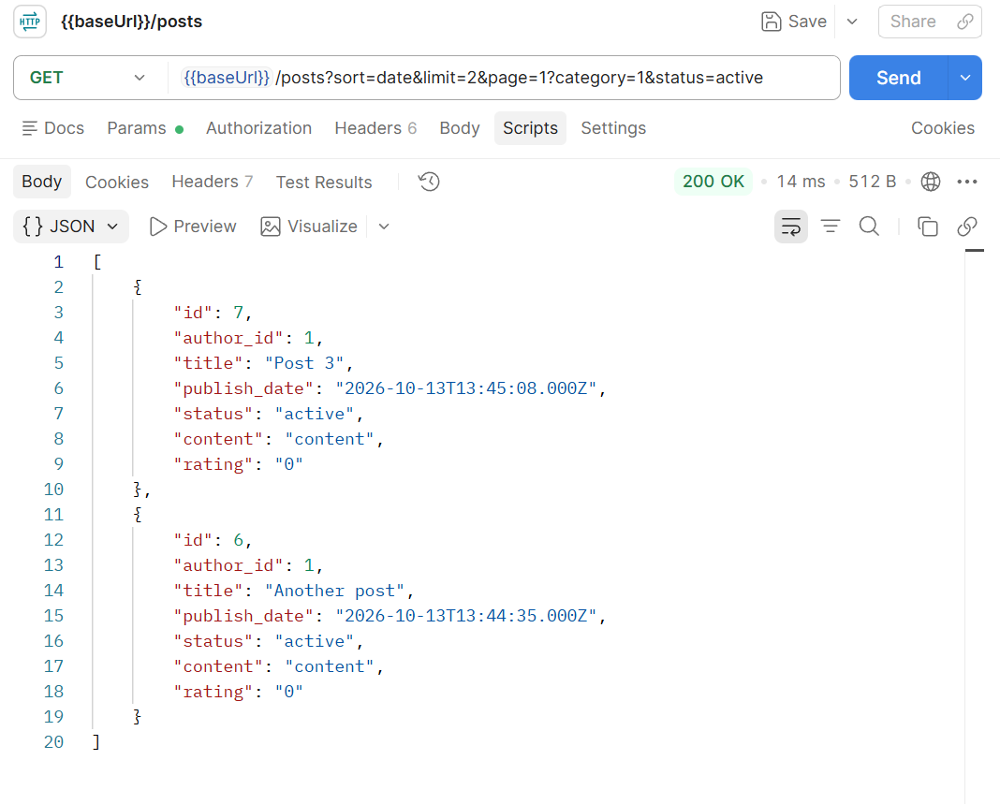

# GeoChill (USOF)

GeoChill is a community forum for finding and sharing great places to visit. Users publish posts about locations (a hidden lake, a picnic spot, a scenic bike route) and describe how to get there by different kinds of transport. Other users leave their impressions in comments, rate posts with likes and dislikes, and the best locations rise to the top of the feed.

The project consists of two parts that live in one repository:

| Part | Folder | Stack |
|------|--------|-------|
| REST API + admin panel (USOF backend) | repository root | Node.js, Express 5, MySQL, AdminJS |
| Web client (USOF frontend) | `frontend/` | React 19, Redux Toolkit, React Router, axios |

## Screenshots

### Application in use







### Database and API




## Features

**Users**
- Registration with e-mail confirmation (a confirmation link is sent by e-mail; only confirmed users can log in).
- Login with login + e-mail + password, JWT token (24 hours), logout.
- Password reset by e-mail link (valid for 15 minutes).
- Profile page: edit login, full name, e-mail and upload an avatar.
- Public profile pages of other users with their posts.

**Posts**
- Create, edit and delete your own posts, assign several categories to each post.
- Attach up to 5 photos to a post (the first photo is the cover in the feed, all photos are shown in a gallery on the post page).
- Pagination, search, filtering by category, sorting by rating or by date (ascending and descending).
- A post can be made `inactive`: it disappears for everyone except its author and admins.

**Comments and reactions**
- Comments under posts, replies to comments (nested threads).
- Like / dislike for posts and comments: one click sets the reaction, a second click on the same reaction removes it.
- Authors and admins can hide (set `inactive`) or delete a comment.
- The rating of a user is calculated automatically (database triggers) as likes minus dislikes under all of their posts and comments.

**News**
- A side panel with news from the administrators (pinned news, a page for each news item, reactions and comments).

**Administration**
- Role-based access: `user` and `admin`.
- Admins can see all posts (including inactive), change the status and categories of any post (but not its content), delete posts and comments, and manage users and categories.
- A full admin panel (AdminJS) is available at `http://localhost:5000/admin`.

## Requirements and dependencies

Install the following on your machine before running the project:

- **Node.js** 18 or newer (with **npm**)
- **MySQL Server** 8.x (the schema uses triggers and window functions)
- A **Gmail account with an app password** (or another SMTP account) for sending confirmation and password reset e-mails

Main backend dependencies: `express`, `mysql2`, `bcrypt`, `jsonwebtoken`, `nodemailer`, `multer`, `cors`, `dotenv`, `adminjs`, `@adminjs/express`, `@adminjs/sql`, `express-session`.

Main frontend dependencies: `react`, `react-dom`, `react-router-dom`, `@reduxjs/toolkit`, `react-redux`, `axios`, `react-scripts`.

## How to run

### 1. Clone and install

```bash
git clone <repository-url>
cd <repository-folder>

# backend dependencies
npm install

# frontend dependencies
cd frontend
npm install
cd ..
```

### 2. Configure environment variables

Copy `.env.example` to `.env` in the repository root and fill it in:

```bash
cp .env.example .env
```

| Variable | Description | Example |
|----------|-------------|---------|
| `DB_HOST` | MySQL host | `localhost` |
| `DB_USER` | MySQL user | `root` |
| `DB_PASSWORD` | MySQL password | `your_password` |
| `DB_NAME` | Database name (created automatically) | `usof_backend` |
| `JWT_SECRET` | Secret for signing tokens (use a long random string) | `change_me` |
| `EMAIL_USER` | Gmail address used to send e-mails | `you@gmail.com` |
| `EMAIL_PASS` | Gmail **app password** (not your normal password) | `abcd efgh ijkl mnop` |
| `PORT` | Backend port | `5000` |
| `FRONTEND_URL` | Address of the web client (used in e-mail links and CORS) | `http://localhost:3000` |

> The frontend expects the API at `http://localhost:5000/api`. The address is set in `frontend/src/services/api.js`.

### 3. Start the backend

Make sure MySQL is running, then from the repository root:

```bash
npm start
```

On the first start the server **creates the database, all tables, triggers and the test data automatically** (see `db-init.js`, `db/db.sql`, `db/seed.sql`). On later starts it detects that the database already exists and leaves it untouched.

To **recreate the database from scratch**, drop it and start the server again:

```sql
DROP DATABASE usof_backend;
```

```bash
npm start
```

The API runs at `http://localhost:5000`, uploaded files are served from `http://localhost:5000/uploads`.

### 4. Start the frontend

In a second terminal:

```bash
cd frontend
npm start
```

The web client opens at `http://localhost:3000`.

### Test accounts

The seed data contains six users. They share the same password written in the first comment of `db/seed.sql`.

| Login | E-mail | Role |
|-------|--------|------|
| `GeoAdmin` | `admin@geochill.local` | admin |
| `TrailBlazer` | `trail@geochill.local` | user |
| `PicnicLover` | `picnic@geochill.local` | user |
| `BikeRider` | `bike@geochill.local` | user |
| `Explorer99` | `explore@geochill.local` | user |
| `EasterEggHunter` | `hunter@geochill.local` | user |

Login requires **login, e-mail and password** together. The admin panel at `/admin` uses the admin **e-mail** and password.

## Project structure

```
.
├── index.js              # entry point: middleware, routes, admin panel, server start
├── db-init.js            # creates the database, schema and seed data on first start
├── admin.js              # AdminJS configuration (admin-only access)
├── config/db.js          # MySQL connection pool
├── db/
│   ├── db.sql            # schema (tables)
│   └── seed.sql          # test data
├── models/               # database access (classes): User, Post, Comment, Category, Like
├── controllers/          # request handling and business rules
├── routes/               # URL → controller mapping
├── middleware/           # authentication (JWT) and file uploads
├── uploads/              # uploaded photos and avatars
├── docs/screenshots/     # screenshots used in this README
└── frontend/
    └── src/
        ├── components/   # Header, PostCard, CommentItem, NewsSidebar, ProtectedRoute, Layout
        ├── pages/        # Home, SinglePost, Profile, CreatePost, EditPost, Login, ...
        ├── redux/        # authentication state
        └── services/     # axios instance
```

The backend follows the **MVC** pattern: models talk to the database, controllers apply business rules and build responses, routes connect URLs to controllers.

## API overview

All endpoints are prefixed with `/api`. Protected endpoints expect the header `Authorization: Bearer <token>`.

**Authentication** (`/api/auth`)

| Method | Path | Description |
|--------|------|-------------|
| POST | `/register` | register a new user |
| GET | `/confirm/:token` | confirm e-mail |
| POST | `/login` | log in (login, email, password) |
| POST | `/logout` | log out |
| POST | `/password-reset` | send a reset link to the e-mail |
| POST | `/password-reset/:token` | set a new password |
| GET | `/me` | current user |

**Users** (`/api/users`): `GET /`, `GET /:id`, `GET /:id/posts`, `POST /` (admin), `PATCH /avatar`, `PATCH /:id`, `DELETE /:id`

**Posts** (`/api/posts`)

| Method | Path | Description |
|--------|------|-------------|
| GET | `/` | list posts (public). Query: `page`, `limit`, `search`, `category`, `sortBy` (`rating` or `publish_date`), `sortOrder` (`ASC`/`DESC`), `status`, `date_from`, `date_to`, `author_id` |
| GET | `/:id` | one post (public) |
| POST | `/` | create a post (`multipart/form-data`, up to 5 `images`) |
| PATCH / PUT | `/:id` | update a post (author, or admin for status and categories only) |
| DELETE | `/:id` | delete a post (author or admin) |
| GET, POST | `/:postId/comments` | list / create comments |
| GET | `/:postId/categories` | categories of a post |
| GET, POST, DELETE | `/:postId/like` | list / set / remove a reaction |

**Comments** (`/api/comments`): `GET /:id`, `PATCH /:id` (status), `DELETE /:id`, `GET`/`POST`/`DELETE /:id/like`

**Categories** (`/api/categories`): `GET /`, `GET /:id`, `GET /:id/posts`, `POST /`, `PATCH /:id`, `DELETE /:id` (create, update and delete are admin-only)

**News** (`/api/news`): `GET /`, `GET /:id`, `POST /` (admin), `PATCH /:id` (admin), `DELETE /:id` (admin), `GET`/`POST /:id/comments`, `POST`/`DELETE /:id/like`

Errors are returned as JSON with an HTTP status code and a message, for example `{ "error": "Post not found or access denied" }`.

## How it works

1. A visitor opens the site and the client requests `GET /api/posts`. Only active posts are returned, sorted by rating by default, ten per page.
2. After registration the server stores the user with a hashed password (bcrypt) and sends an e-mail with a signed link. The link opens the client page that calls `GET /api/auth/confirm/:token`; after that the user can log in.
3. On login the server returns a JWT containing the user id and role. The client keeps it and sends it with every request; the `auth` middleware decodes it and puts the user into `req.user`. Public endpoints use an optional version of the middleware so the server knows who is asking and can show an author their own inactive posts.
4. Controllers check permissions by role and ownership (for example, only the author or an admin can delete a comment).
5. A like or dislike is stored in the `Likes` table (one reaction per user per post or comment). MySQL triggers recalculate the rating of the content author automatically.
6. Uploaded photos are saved to the local `uploads/` folder, their file names are stored in `Post_Images`, and the server serves the folder as static files.

## Progress by CBL stages

- **Engage / Investigate:** studied the task requirements, chose Node.js + Express + MySQL, designed the entities (users, posts, categories, comments, likes) and the endpoint structure.
- **Act: Basic (backend):** authentication with e-mail confirmation and password reset, role-based access, CRUD for all entities, filtering, sorting, pagination, automatic database creation with test data, admin panel.
- **Act: Basic (frontend):** React client for every endpoint: header with search and user info, main page, profile, post pages, nested comments, reactions, responsive layout, input validation with error messages.
- **Act: Creative:** photo galleries for posts, news panel with admin announcements, reactions on news, category filter on the main page, e-mail templates.

## Known limitations and notes

- Latitude and longitude columns exist in the `Posts` table and API, but the web client does not show a map yet.
- Do not create users through the AdminJS panel: it stores the password exactly as typed. Use `POST /api/users` (admin) or the registration form instead.
- Real e-mail delivery needs valid Gmail credentials in `.env`. For a quick local test a user can be confirmed manually: `UPDATE Users SET is_verified = 1 WHERE login = '...';`

## Style guides

JavaScript code follows the JavaScript Style Guide and Coding Conventions (W3Schools), Node.js Best Practices and the SQL style guide; the frontend follows the Google HTML/CSS Style Guide and the Airbnb React/JSX Style Guide.

## Full Documentation (CBL Journal)
**[Link to Google Docs](https://docs.google.com/document/d/1odM1WeAlmNvR1FL1DnYfossgR-hkyyL-/edit?usp=sharing&ouid=110874172219210610441&rtpof=true&sd=true)**

