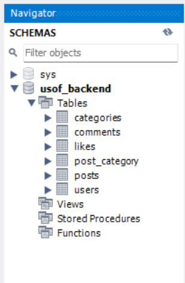
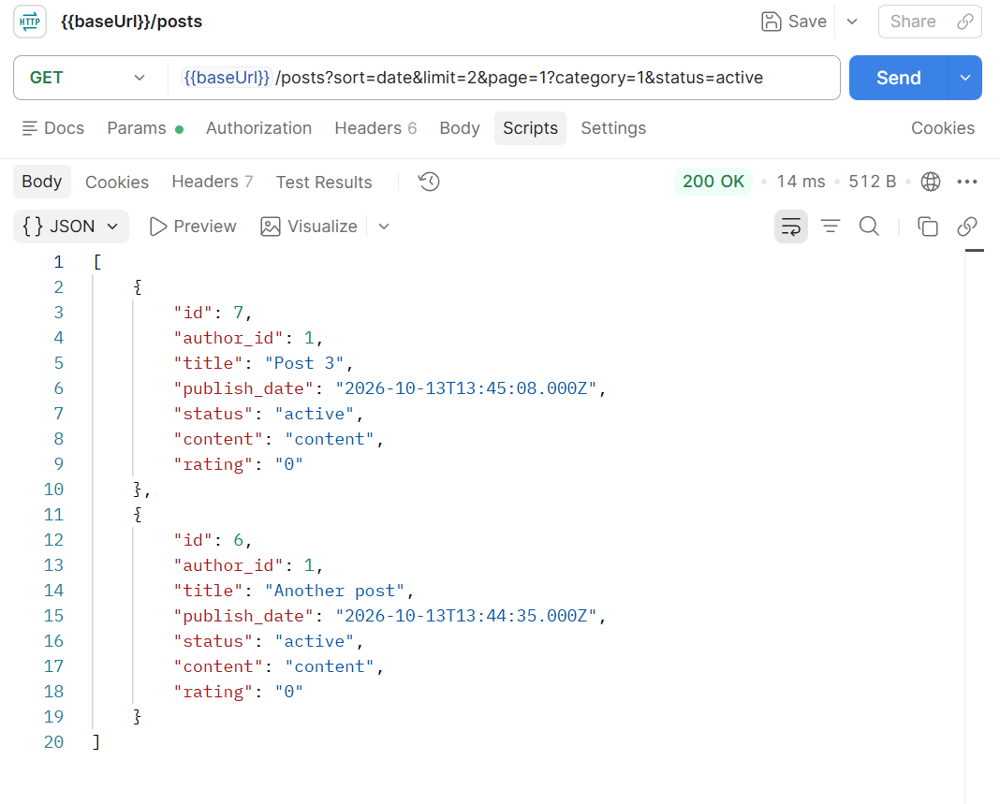

# USOF Backend

## Short Description
This is the backend RESTful API for a community-driven platform where users share and discover interesting outdoor locations, picnic spots, and travel routes for various types of transport. The API is built using Node.js and Express, following the MVC architecture, and uses MySQL as a relational database. It includes secure JWT authentication, role-based access control (Admin/User), and a fully functional reaction system.

## Features
- **User Authentication:** Registration, login, and password reset via email (`nodemailer`) using JWT.
- **Role-Based Access Control:** Strict differentiation between `admin` and `user` permissions.
- **Posts & Categories:** Full CRUD operations, dynamic SQL filtering, sorting by rating/date, and pagination.
- **Comments & Reactions:** Nested comments for posts and a toggle-based like/dislike system using `ON DUPLICATE KEY UPDATE`.
- **Media Uploads:** Avatar uploading using `multer`.

## Screenshots



## Requirements and Dependencies
To build and run this project, you need the following installed on your machine:
- **Node.js** (v14.x or higher)
- **MySQL Server** (v8.x)
- **npm** (Node Package Manager)

**Main Dependencies:**
- `express` - Web framework
- `mysql2` - MySQL client for Node.js
- `bcrypt` - Password hashing
- `jsonwebtoken` - Secure API routes
- `nodemailer` - Email sending functionality
- `dotenv` - Environment variable management
- `multer` - File uploads

## How to Run the Solution

1. **Clone the repository:**
   ```bash
   git clone <repository-url>
   ```

2. **Install dependencies:**
   ```bash
   npm install
   ```

3. **Database Setup:**
   Open MySQL (via CLI, Workbench, or DBeaver) and run the provided SQL script to construct the tables:
   ```bash
   mysql -u root -p < db.sql
   ```

4. **Environment Configuration:**
   Create a `.env` file in the root directory and add the following variables:
   ```env
   PORT=3000
   DB_HOST=localhost
   DB_USER=root
   DB_PASSWORD=your_mysql_password
   DB_NAME=usof_backend
   JWT_SECRET=your_super_secret_jwt_key
   EMAIL_USER=your_test_email@gmail.com
   EMAIL_PASS=your_google_app_password
   ```

5. **Start the server:**
   ```bash
   npm start
   ```
   The API will be available at `http://localhost:3000/api/`.

## Full Documentation (CBL Journal)
**[Link to Google Docs](https://docs.google.com/document/d/1kxDFYEI5t9V14O5gT5jZ31UaUNEgWRuIBvDQF19EAfM/edit?usp=sharing)**